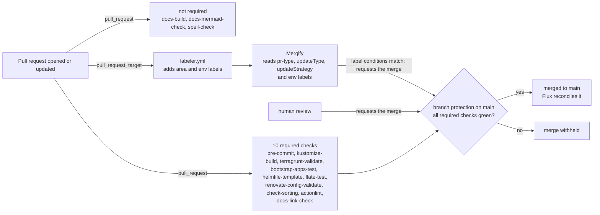

# CI

There is no application source code in this repo, so CI focuses on infrastructure and configuration validation rather than application unit tests: linting and formatting, manifest rendering and validation, plus a bootstrap test that applies part of the `helmfile` against a throwaway cluster. The repository has 15 workflow files: 11 validation workflows, three non-required docs checks ([`docs-mermaid-check.yml`](../../.github/workflows/docs-mermaid-check.yml), [`spell-check.yml`](../../.github/workflows/spell-check.yml) and the scheduled [`docs-link-check-external.yml`](../../.github/workflows/docs-link-check-external.yml), which has no `pull_request` trigger), and one PR-labeling workflow. All 11 validation workflows run on every `pull_request` and push to `main`; `labeler.yml` runs on `pull_request_target`. 10 of the 11 validation workflows are required status checks on `main` (`docs-build` is not required yet, see its row below): `pre-commit`, `kustomize-build`, `terragrunt-validate`, `bootstrap-apps-test`, `helmfile-template`, `flate-test`, `renovate-config-validate`, `check-sorting`, `actionlint`, and `docs-link-check`. Keep this list in sync with `main`'s branch protection when required checks change. A red or missing required check blocks merge at the GitHub level, not just by convention. `kustomize-build`, `terragrunt-validate`, and `bootstrap-apps-test` each run a cheap `changes` job first (`dorny/paths-filter`, with `predicate-quantifier: 'some-with-excludes'` — the library's default doesn't actually honor `!`-prefixed exclusion patterns, confirmed the hard way on [#1511](https://github.com/isejalabs/homelab/issues/1511)) and gate their real work on it with a job-level `if:`, rather than a workflow-level `paths:` trigger filter. A job skipped this way reports status `Success`, unlike a workflow that never starts at all — confirmed live on [PR #1517](https://github.com/isejalabs/homelab/pull/1517), a genuinely unrelated change, where all three showed `skipping` rather than running for real or blocking. That distinction is what made adding them safe: GitHub's required-status-checks feature has no "only count checks that actually ran" semantic, so a workflow that never starts at all looks identical to "still running" and blocks merge forever.

## Workflows

| Workflow | Role | Checks | Typical runtime |
| --- | --- | --- | --- |
| [`pre-commit.yml`](../../.github/workflows/pre-commit.yml) | Required validation | the repo's own `pre-commit` hooks (`.pre-commit-config.yaml`: `forbid-secrets`, `validate-sops`) | ~10s |
| [`kustomize-build.yml`](../../.github/workflows/kustomize-build.yml) | Required validation | `kustomize build` + `kubeconform` across every `k8s/` overlay, plus a guard that no `flux/ks.yaml` sets `spec.targetNamespace` and a check that each `keycloak-realm` Terragrunt unit's `keycloak_url` equals the hostname its environment's Keycloak overlay serves (`scripts/kustomize-build-all.sh`) | ~1m15s-1m30s |
| [`terragrunt-validate.yml`](../../.github/workflows/terragrunt-validate.yml) | Required validation | `tofu fmt -check`, `terragrunt hcl format --check`, and `terragrunt init -backend=false` + `validate` across every `terragrunt/` unit (`scripts/terragrunt-validate-all.sh`); a `prod` or `qa` unit without a committed `.terraform.lock.hcl` fails, and those units are init'd with `-lockfile=readonly`, so an incomplete lock fails too (see [Provider lock files](../../terragrunt/README.md#provider-lock-files)) | ~2m20s-3m0s, occasionally much longer |
| [`bootstrap-apps-test.yml`](../../.github/workflows/bootstrap-apps-test.yml) | Required validation | the bootstrap `helmfile` "apps" stage against an ephemeral `kind` cluster (`scripts/bootstrap-apps-ci-test.sh`) — the only workflow that actually applies anything, rather than just rendering/linting | ~2m30s-3m55s |
| [`helmfile-template.yml`](../../.github/workflows/helmfile-template.yml) | Required validation | renders `k8s/bootstrap/helmfile/{crds,apps}` for every environment, to catch `.gotmpl` errors (`scripts/helmfile-template-all.sh`) | ~20s-30s |
| [`flate-test.yml`](../../.github/workflows/flate-test.yml) | Required validation | `flate test all` — cross-resource Flux validation against every environment's top-level sync target (`scripts/flate-test-all.sh`) | ~20s-45s |
| [`renovate-config-validate.yml`](../../.github/workflows/renovate-config-validate.yml) | Required validation | `renovate-config-validator` against `.github/renovate.json5` and its includes | ~30s-40s |
| [`check-sorting.yml`](../../.github/workflows/check-sorting.yml) | Required validation | leading-field/`metadata` key ordering conformance with [`.agents/instructions/sorting.md`](../../.agents/instructions/sorting.md) (`scripts/check-sorting.py`) — partial: that ordering only, not full list-sorting | ~10s |
| [`actionlint.yml`](../../.github/workflows/actionlint.yml) | Required validation | lints the workflow files themselves | ~15s-20s |
| [`docs-link-check.yml`](../../.github/workflows/docs-link-check.yml) | Required validation | `lychee --offline --include-fragments` across every `*.md` file, catching a dangling reference to a file or `#anchor` that moved or was deleted — including a non-markdown file a doc links to, so deliberately not `paths:`-filtered to just markdown (see [#1349](https://github.com/isejalabs/homelab/issues/1349)); also runs `scripts/check-workloads-catalog.sh`, which fails when the tables in [`workloads.md`](workloads.md) and the Flux sets in `k8s/bootstrap/cluster/flux/sets/` disagree (a unit missing from the table, a row without a unit, or a different `Flux set`) — folded in here rather than made a separate required check, because it is a docs-consistency check that needs no tooling beyond POSIX `sh`/`awk` and should run on every PR | ~10s-20s |
| [`docs-build.yml`](../../.github/workflows/docs-build.yml) | Validation, not required yet | `mkdocs build --strict` of the documentation site ([ADR 0017](../decisions/0017-docs-site-generator.md), config in [`.ci/mkdocs/`](../../.ci/mkdocs)), so a broken relative link or `#anchor` fails the build. Gated by the same job-level `dorny/paths-filter` pattern as `kustomize-build`, so a skip is safe to require later. On `main` it also uploads the site and, only while the repository variable `DOCS_PAGES_PUBLISH` is `true`, deploys it to GitHub Pages (`pages: write`, `id-token: write` on that job only) | ~30s |
| [`docs-mermaid-check.yml`](../../.github/workflows/docs-mermaid-check.yml) | Non-required validation | parses every `mermaid` fence in the `*.md` files with the Mermaid CLI (`mmdc`, pinned in [`docs/.mise.toml`](../../docs/.mise.toml)); GitHub renders invalid Mermaid as an error box instead of failing, so this is what catches a syntax error. Runs only when a Markdown file, the pin or the workflow changes, which is why it is not a required check; see [Diagrams](../README.md#diagrams) for the conventions | ~30s-1m |
| [`spell-check.yml`](../../.github/workflows/spell-check.yml) | Advisory, not required | `typos` over every `*.md` file (see [Spell check](#spell-check-advisory)) | ~15s |
| [`docs-link-check-external.yml`](../../.github/workflows/docs-link-check-external.yml) | Scheduled, never on a PR | `lychee` online over the external URLs in every `*.md` file (see [External link check](#external-link-check-scheduled)) | not run yet, see the follow-ups of the introducing PR |
| [`labeler.yml`](../../.github/workflows/labeler.yml) | PR automation | applies `area:*`/`env:*` labels to the PR itself (see below) | ~5s |

Phase 2 — checks that need a live/ephemeral cluster beyond what `bootstrap-apps-test.yml` already covers (`flux-local`, policy checks) — is tracked separately in [#1209](https://github.com/isejalabs/homelab/issues/1209). Anything not covered by the table above is still validated manually via `helmfile template` (used implicitly by `just bootstrap::cluster`) and Flux's own reconciliation status.

## How a pull request reaches `main`

The diagram shows which workflows a pull request triggers and where the merge decision sits. Which Renovate pull requests Mergify merges on its own is a separate decision, drawn in [`update-handling.md`](../operations/update-handling.md#how-a-renovate-pull-request-gets-merged).

Mergify never looks at CI status itself; the required checks are what stop a merge it requests (see [PR labeling and Mergify](#pr-labeling-and-mergify)).

## Docs checks that don't block a PR

The required `docs-link-check` stays offline on purpose. Two further checks cover what it leaves out, and neither is in `main`'s required-check list.

### External link check (scheduled)

[`docs-link-check-external.yml`](../../.github/workflows/docs-link-check-external.yml) runs `lychee` online (http and https URLs only, `lychee` pinned in [`.mise.toml`](../../.mise.toml) like the offline check) every Monday and on `workflow_dispatch`. It has no `pull_request` trigger, so a dead URL cannot block a merge.

It keeps exactly one tracking issue, titled `docs: external links in the documentation are dead`, found by that title among the open issues:

- Broken links and no open issue: it opens one (label `documentation`) with the `lychee` report.
- Broken links and an open issue: it replaces the issue body with the new report.

Each broken link is a task list item (`- [ ] ...`), so single items can be converted to sub-issues by hand with GitHub's "Convert to sub-issue"; nothing is converted automatically. Because every run rewrites the body, task items without a URL (what GitHub leaves behind after a conversion) are carried over under a `## Triaged` heading. A link that stays broken is listed again as a new item.
- No broken link and an open issue: it closes the issue with a comment.

HTTP 429 counts as alive (a rate limit says nothing about the link); the `iseja.net` hosts, `localhost` and the `example.com`/`example.org` placeholders are excluded, as is the private repository `sebiklamar/salt-iseja.net`, which the workflow token can't read, so its links would always look dead. `_attic` and `ZZ.bak` are skipped as retired material, and so is `docs/audits`: audits are never edited after the fact ([`docs/audits/README.md`](../audits/README.md)), so a dead URL there can't be fixed. The offline check still covers the audits. The exit codes 0 and 2 of `lychee` are handled; any other exit code fails the job, which is the signal that the check itself broke. To run it by hand: `gh workflow run docs-link-check-external.yml`.

### Spell check (advisory)

[`spell-check.yml`](../../.github/workflows/spell-check.yml) runs [`typos`](https://github.com/crate-ci/typos) over every tracked `*.md` file on pull requests and pushes that touch Markdown, the config or the workflow itself. It is not a required check, so a hit shows red on the PR and blocks nothing. Promote it to required (and update the lists in this file and in [`AGENTS.md`](../../AGENTS.md)) only after it has stayed quiet for a while.

- **Project dictionary and exclusions**: [`.ci/typos/typos.toml`](../../.ci/typos/typos.toml). `extend-words` holds words `typos` would otherwise "correct" (today `flate`, the Flux validation tool, and `RTO`). `extend-exclude` skips `docs/audits/` (never edited after the fact), `_attic/`, `ZZ.bak/`, the `.commons` submodule and sops files. Add a word to `extend-words` instead of rewording a document to please the check.
- **Version**: pinned in the workflow (`typos==1.51.1` through `pipx run`), not in `.mise.toml`. A tool added there needs `mise.lock` checksums and is installed by every workflow that runs `mise-action` without `install_args`, for a check that only this workflow uses.
- **Run it locally**: `git ls-files -z '*.md' | xargs -0 pipx run --spec typos==1.51.1 typos --config .ci/typos/typos.toml --force-exclude --format brief`.
- **What it does not catch**: `typos` flags known misspellings, it does not check against a full dictionary and it does not read grammar. A word that is a misspelling of nothing known (such as `whigh` in `k8s/bootstrap/README.md`) or a dropped letter that leaves a valid word (`t is the law`) passes. A full-dictionary checker would catch the first, but it flagged about 270 words of this repo's vocabulary (Kubernetes kinds, tool and host names) even with inline code ignored, so it was not adopted.

## Tool provisioning

Every workflow that needs more than the Ubuntu runner's stock toolset uses [`jdx/mise-action`](https://github.com/jdx/mise-action), which installs whatever the resolved `.mise.toml`'s `[tools]` table declares — that table is shared with local dev (`direnv`/`mise` picks it up on `cd`), so CI and a human running the same script locally get the same tool versions. A workflow's own `install_args:` on the `mise-action` step is only for tools genuinely specific to that one workflow and not worth adding to a shared table (there aren't any of these today — every current `install_args` entry, e.g. `kustomize-build.yml`'s `gum kubeconform kubectl`, actually names tools already declared somewhere, which is harmless redundancy, not a second source of truth).

Three `.mise.toml` files exist, not one: the root one, plus [`terragrunt/.mise.toml`](../../terragrunt/.mise.toml) (`opentofu`/`talosctl`/`terragrunt`) and [`k8s/.mise.toml`](../../k8s/.mise.toml) (`kustomize`/`kubeconform`). mise resolves config by walking up from the current directory and merging every `.mise.toml` it finds, so `terragrunt-validate.yml`/`kustomize-build.yml` set `working_directory: terragrunt`/`working_directory: k8s` on their `mise-action` step (an existing action input) to pick up the directory-scoped file merged with the root one, rather than needing an explicit include. This split exists so a bump to a terragrunt-only or k8s-only tool doesn't also retrigger the *other* workflow — see [#1426](https://github.com/isejalabs/homelab/issues/1426). Tools used by two or more workflows (`kubectl`, `helm`, `gum`, ...) stay in the root file rather than being split further, since moving a shared tool out would need every consumer's `working_directory` updated in lockstep to keep resolving the same pinned version.

`terragrunt-validate.yml` additionally sets `TF_PLUGIN_CACHE_DIR` so its 26 terragrunt units share one provider-download cache within a run, and persists that cache *across* runs too via `actions/cache`, keyed on every `terragrunt.hcl` plus `terragrunt/.mise.toml` (see [#1416](https://github.com/isejalabs/homelab/issues/1416)).

## PR labeling and Mergify

[`.github/labeler.yml`](../../.github/labeler.yml), run by `labeler.yml` on `pull_request_target`, applies `area:*` labels (by which top-level directories changed) and `env:*` labels (by which environment's overlay/terragrunt unit changed) to every PR. These aren't purely cosmetic: Mergify ([`.github/mergify.yml`](../../.github/mergify.yml)) reads `label=pr-type:renovate` and `label=env:head`/`label=updateType:minor`-style conditions to decide which Renovate PRs to auto-merge. `area:terraform` covers `.mise.toml`/`mise.lock` version bumps too (see [#1416](https://github.com/isejalabs/homelab/issues/1416)) — accepting that this flags on any tool's bump in that shared file, not just terragrunt/opentofu's, since path matching is file-level, not line-level. `area:docs` had a real mislabeling bug (fixed in [#1416](https://github.com/isejalabs/homelab/issues/1416)/[#1425](https://github.com/isejalabs/homelab/pull/1425) — see those for the two-part history) and now matches `docs/**`/`**/README.md` only, deliberately not the broader `**/*.md` that caused it. **Known caveat as of this writing**: a workflow reading `github.event.pull_request.labels` can't reliably see a label this same PR's `labeler.yml` run is about to add, since both trigger off the same webhook event but run as independent jobs — don't gate CI on labels for this reason (see #1416's "Alternatives considered").

Mergify's own merge conditions never check CI status — only labels. Before `main`'s branch protection existed, that meant a label match alone was enough for Mergify to merge, regardless of whether the required checks above had even finished. Branch protection now closes that gap for free: Mergify merges via a normal (non-bypass) write operation, so GitHub itself withholds the merge until the required checks pass, on top of Mergify's own label conditions — no change to `mergify.yml` was needed.

## What isn't covered here

- Phase 2 (live/ephemeral-cluster checks beyond `bootstrap-apps-test.yml`, policy checks) — [#1209](https://github.com/isejalabs/homelab/issues/1209).
- Reducing CI runtime (path-based skipping, provider-download caching) — [#1416](https://github.com/isejalabs/homelab/issues/1416).
