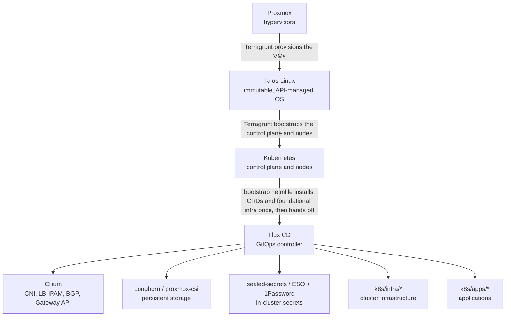

# Architecture overview

The homelab is a stack of layers, each provisioned/reconciled by the tool suited to it, handing off to the next: **Proxmox** hosts VMs, **Talos Linux** is the immutable OS those VMs run, **Kubernetes** is what Talos bootstraps, and **Flux CD** continuously reconciles everything Kubernetes-side from this repo. This page is the entry point into that picture — it links to the architecture doc that actually explains each layer rather than duplicating it; see [`docs/README.md`](../README.md) for the full documentation map.

## The stack, top to bottom

Where each step is documented: the Terragrunt layer in [`terragrunt/README.md`](../../terragrunt/README.md), the handoff in [`k8s/bootstrap/README.md`](../../k8s/bootstrap/README.md), the shared `base/envs/flux` shape Flux reconciles in [`kustomize.md`](kustomize.md), Cilium in [`network.md`](network.md), storage in [`storage.md`](storage.md), secrets in [`secrets.md`](secrets.md), and the infra and app units in [`workloads.md`](workloads.md).

Every one of the 8 environments (`dbg`, `dev`, `head`, `poc`, `prod`, `qa`, `rebuild`, `src`) goes through this exact same stack — what differs between them is parameterized, not a different pipeline. See [`environments.md`](environments.md) for what actually varies per environment.

## Infrastructure: Proxmox → Talos → Kubernetes

[Terragrunt](../../terragrunt/README.md) provisions Proxmox VMs and installs Talos on them, per environment, from reusable OpenTofu modules. This is the only layer below Kubernetes — once it's done, a Talos-managed Kubernetes control plane and nodes exist, with nothing running on them yet.

## Handoff: bootstrap helmfile → Flux

A fresh cluster has no Flux, no CRDs, no CNI — `helmfile` installs that foundational layer directly (Cilium, sealed-secrets, cert-manager, external-secrets, 1Password Connect, the Flux operator/instance), then Flux takes over reconciling everything else from Git. See [`k8s/bootstrap/README.md`](../../k8s/bootstrap/README.md) for the full install order and dependency chain.

From here on, every app/infra unit Flux reconciles follows the same `base/` + `envs/<env>/` + `flux/` kustomize shape, composed through a shared DRY `components` layer — see [`kustomize.md`](kustomize.md).

## Cross-cutting components

These aren't a step in the pipeline above — they're consumed by apps/infra at every layer once Flux is running:

- **Networking** — Cilium (CNI, LB-IPAM, BGP route advertisement, Gateway API), AdGuard + Unbound (DNS resolution), and where the physical network (OPNsense, UCS, the root nameservers) picks up outside this repo entirely. See [`network.md`](network.md).
- **Storage** — Longhorn vs. proxmox-csi, and which volumes need which. See [`storage.md`](storage.md).
- **Secrets** — SOPS below the cluster, sealed-secrets/1Password+ESO above it, bridged once at bootstrap. See [`secrets.md`](secrets.md).
- **Monitoring** — Checkmk sites outside the clusters, fed by the in-cluster `checkmk-agent`, custom storage special agents and host agents. See [`monitoring.md`](monitoring.md).

## What's actually deployed, and where the repo's boundary is

[`workloads.md`](workloads.md) is the full catalog of every app/infra component Flux reconciles — what it is and how it's installed. This repo isn't the whole homelab, though: Proxmox hosts, TrueNAS, and some Linux/LXC configuration are managed outside it (Salt, manual). See [`repositories.md`](repositories.md) for how work is split across repos and tools.
