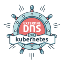
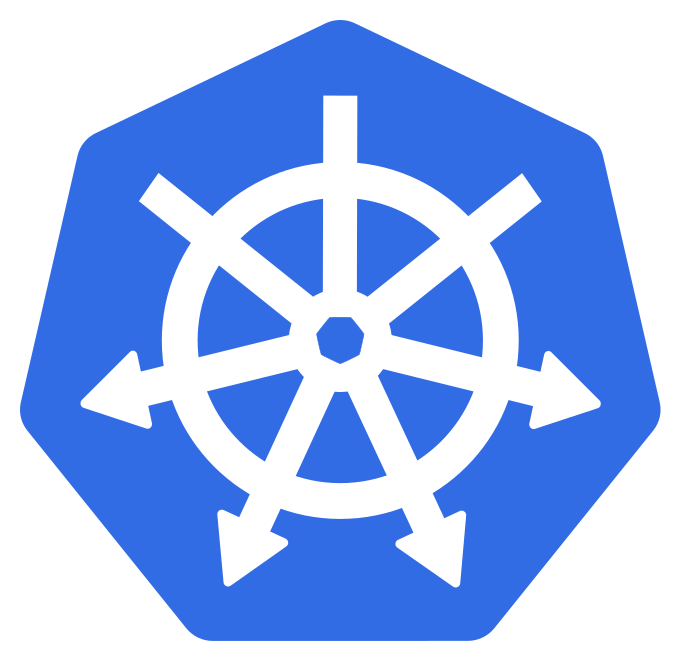
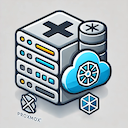

# Cluster workload

A catalog of everything actually running in the cluster — every app under [`k8s/apps/`](../../k8s/apps/) and every infra component under [`k8s/infra/`](../../k8s/infra/) — in the spirit of [billimek/k8s-gitops](https://github.com/billimek/k8s-gitops/)'s single-table workload overview. This doc only says **what** runs and **where**; for **how** the pieces work, see the other architecture docs it links out to rather than duplicates: [`kustomize.md`](kustomize.md) for the `base`/`envs/<env>`/`flux` overlay shape every entry below follows, and [`environments.md`](environments.md) for the minimal-vs-full app split referenced throughout.

**Order and icons**: both tables are sorted alphabetically by `App`/`Component` name — not by category and not by `Flux set`, so a unit stays findable without knowing where it is wired in — and the `Category` and `Flux set` columns say where a unit lives and which environments get it. Every row carries one icon in front of its name, purely decorative and ignored by the catalog check: the project's own logo where one could be found (stored in [`assets/icons/`](../assets/icons/), with its source in the [`README.md`](../assets/icons/README.md) there, as a raw `` at 20 px so it renders the same on github.com and on the docs site), and a fitting emoji only for a unit with no logo of its own (`metrics-server`, `whoami`, `kubelet-serving-cert-approver`, `ns`, `snapshot-controller`). Companion units of one project share its logo (`longhorn`/`longhorn-core`, `gateway`/`gateway-api-crds`, `kopiur`/`kopiur-repository`, `keycloak`/`keycloak-operator`).

**Authoritative fields, and keeping this current**: `Category`/`App`/`Component` and `Manifest` are derived directly from the directory under `k8s/apps/`/`k8s/infra/` and its `base/` contents; `Flux set` and `Bootstrap helmfile?` are derived from `k8s/bootstrap/cluster/flux/sets/*/kustomization.yaml` and the bootstrap helmfiles respectively — all four are checkable against the repo, not editorial judgment; `scripts/check-workloads-catalog.sh` (run by the `docs-link-check` CI check) enforces the `Category`/`App`/`Component` and `Flux set` columns. `What it is` is the one free-text field; keep it to what the thing *is*, linking out to an architecture doc for *why*. The `App`/`Component` link opens the unit's folder, whose `README.md` (template in [`k8s/README.md`](../../k8s/README.md#readme-of-an-appinfra-unit), rollout tracked in [#2098](https://github.com/isejalabs/homelab/issues/2098)) holds what this catalog deliberately does not: where to reach it per environment, where its versions are pinned, and its commands. Per the standing ownership convention ([`docs/README.md`](../README.md#ownership)), add a row here in the same PR that wires a new unit into a Flux set — this table drifting from the Flux sets it's supposed to mirror is exactly the kind of gap [#1342](https://github.com/isejalabs/homelab/issues/1342) found and fixed.

## Apps (`k8s/apps/`)

Every environment gets the **minimal** apps (marked `minimal` below); only `head`, `prod`, `qa`, `rebuild` also get the **optional** ones (see [`environments.md`](environments.md#1-which-apps-run-there--the-flux-minimalfull-split)).

| Category | App | What it is | Manifest | Flux set |
| --- | --- | --- | --- | --- |
| `finances` |  [`actualbudget`](../../k8s/apps/finances/actualbudget/) | [Actual Budget](https://github.com/actualbudget/actual) — personal finance/budgeting app | HelmRelease (`community-charts`) | optional |
| `dns` |  [`adguard`](../../k8s/apps/dns/adguard/) | [AdGuard Home](https://github.com/AdguardTeam/AdGuardHome) — LAN DNS filtering/ad-blocking (see [`network.md`](network.md#dns-adguard--unbound)) | raw Deployment/Service, not a Helm chart | optional |
| `monitoring` |  [`checkmk-agent`](../../k8s/apps/monitoring/checkmk-agent/) | [Checkmk](https://checkmk.com/) Kubernetes monitoring agent (cluster + node collectors) | HelmRelease (`checkmk.github.io/checkmk_kube_agent`) | minimal |
| `identity` |  [`keycloak`](../../k8s/apps/identity/keycloak/) | [Keycloak](https://www.keycloak.org/) identity provider (single replica) with its [CloudNativePG](https://cloudnative-pg.io/) database (1 instance, no WAL archiving; daily `pg_dump` to RustFS, see [`keycloak-backup-restore.md`](../identity/keycloak-backup-restore.md)) — [#1826](https://github.com/isejalabs/homelab/issues/1826) | Keycloak/CloudNativePG custom resources | `soaking` — registered in `dev`, `qa` and `rebuild` only until the soak is done, see [`sets/soaking`](../../k8s/bootstrap/cluster/flux/sets/soaking/kustomization.yaml) |
| `monitoring` | 📊 [`metrics-server`](../../k8s/apps/monitoring/metrics-server/) | Kubernetes [`metrics-server`](https://github.com/kubernetes-sigs/metrics-server) (resource metrics for `kubectl top`/HPA) | HelmRelease (OCI chart) | minimal |
| `dns` |  [`powerdns`](../../k8s/apps/dns/powerdns/) | [PowerDNS](https://www.powerdns.com/) — authoritative nameserver for the environment's own `<env>.iseja.net` zone (and PTR), dynamically populated by `external-dns` below (see [`network.md`](network.md#dns-authoritative-zones-powerdns)) | HelmRelease (`bjw-s-labs/app-template` OCI chart) | minimal |
| `dns` |  [`unbound`](../../k8s/apps/dns/unbound/) | [Unbound](https://github.com/NLnetLabs/unbound) — recursive/validating DNS resolver, AdGuard's upstream for the internal domain (see [`network.md`](network.md#dns-adguard--unbound)) | raw Deployment/Service, not a Helm chart | optional |
| `network` |  [`unifi-controller`](../../k8s/apps/network/unifi-controller/) | [UniFi Network Application](https://www.ui.com/) — management UI for the physical WiFi APs/switches (see [`network.md`](network.md#physical-network-opnsense-ucs-and-the-root-nameservers)) | raw Deployment/Service, not a Helm chart | optional |
| `network` |  [`unifi-mongodb`](../../k8s/apps/network/unifi-mongodb/) | MongoDB backing store for `unifi-controller` above, on proxmox-csi (see [`storage.md`](storage.md)) | raw Deployment/Service, not a Helm chart | optional |
| `diag` | 🙋 [`whoami`](../../k8s/apps/diag/whoami/) | Traefik's [`whoami`](https://github.com/traefik/whoami) HTTP echo/debug server (`ghcr.io/traefik/whoami`) | raw Deployment/Service | minimal |
| `home-automation` |  [`zigbee2mqtt`](../../k8s/apps/home-automation/zigbee2mqtt/) | [Zigbee2MQTT](https://www.zigbee2mqtt.io/) — bridge between the Zigbee network (ConBee II passed through to one worker) and the MQTT broker for Home Assistant | HelmRelease (`app-template`) | none — registered in `prod` only, because there is a single physical coordinator |

## Infra (`k8s/infra/`)

Every environment gets the **full** infra set — both `minimal` and `optional` — regardless of which app set it runs (see [`environments.md`](environments.md#1-which-apps-run-there--the-flux-minimalfull-split)). A few of these are installed live by the bootstrap `helmfile` *before* Flux exists, in the dependency order shown under [Bootstrap install order](#bootstrap-install-order) (this table is alphabetical, not in install order), then handed off to Flux for ongoing management — see [`k8s/bootstrap/README.md`](../../k8s/bootstrap/README.md) for the full bootstrap walkthrough; this table only says which ones.

| Category | Component | What it is | Bootstrap helmfile? | Flux set |
| --- | --- | --- | --- | --- |
| `cert-manager` |  [`cert-manager`](../../k8s/infra/cert-manager/cert-manager/) | [cert-manager](https://cert-manager.io/), Gateway API support enabled (see [`network.md`](network.md#gateway-api-cilium-as-the-implementation)) | yes — needs `sealed-secrets` | minimal |
| `kube-system` |  [`cilium`](../../k8s/infra/kube-system/cilium/) | [Cilium](https://cilium.io/) — CNI, kube-proxy replacement, Gateway API implementation, LB-IPAM, BGP (see [`network.md`](network.md#cilium-lb-ipam-and-bgp-route-advertisement)) | yes — first release, everything else `needs` it | minimal |
| `cnpg-system` |  [`cloudnative-pg`](../../k8s/infra/cnpg-system/cloudnative-pg/) | [CloudNativePG](https://cloudnative-pg.io/) PostgreSQL operator | no — Flux-only | `soaking` |
| `external-dns` |  [`external-dns`](../../k8s/infra/external-dns/external-dns/) | [external-dns](https://github.com/kubernetes-sigs/external-dns) — populates `powerdns` above via RFC2136/TSIG (see [`network.md`](network.md#dns-authoritative-zones-powerdns)) | no — Flux-only | minimal |
| `external-secrets` |  [`external-secrets`](../../k8s/infra/external-secrets/external-secrets/) | [External Secrets Operator](https://external-secrets.io/) (see [`secrets.md`](secrets.md)) | yes — needs `cilium` | minimal |
| `flux-system` |  [`flux-instance`](../../k8s/infra/flux-system/flux-instance/) | The `FluxInstance` CR — the actual Flux controllers, pointed at this repo/branch. Installing this is the bootstrap → Flux handoff point | yes — needs `flux-operator`; last bootstrap step | minimal |
| `flux-system` |  [`flux-operator`](../../k8s/infra/flux-system/flux-operator/) | ControlPlane's [Flux Operator](https://github.com/controlplaneio-fluxcd/flux-operator) | yes — needs `cert-manager` | minimal |
| `gateway-api` |  [`gateway`](../../k8s/infra/gateway-api/gateway/) | The actual `Gateway`/`HTTPRoute`/`Certificate` resources (see [`network.md`](network.md#gateway-api-cilium-as-the-implementation)) | no — Flux-only | minimal |
| `gateway-api` |  [`gateway-api-crds`](../../k8s/infra/gateway-api/gateway-api-crds/) | Upstream Gateway API CRDs (standard + experimental `TLSRoute`), manifests from a GitHub release, vendored under `base/vendor/` | no — Flux-only | minimal |
| `keycloak` |  [`keycloak-operator`](../../k8s/infra/keycloak/keycloak-operator/) | [Keycloak Operator](https://www.keycloak.org/operator/installation), CRDs and manifest from a GitHub release, vendored under `base/vendor/` | no — Flux-only | `soaking` |
| `kopiur-system` |  [`kopiur`](../../k8s/infra/kopiur-system/kopiur/) | [kopiur](https://github.com/home-operations/kopiur) backup/restore operator, kopia-based (see [`storage.md`](storage.md) and [`docs/backup/kopiur-backup-restore.md`](../backup/kopiur-backup-restore.md)) | no — Flux-only | optional |
| `kopiur-system` |  [`kopiur-repository`](../../k8s/infra/kopiur-system/kopiur-repository/) | `fiona`, kopiur's `ClusterRepository` pointing at this cluster's S3-compatible NAS, one bucket per environment | no — Flux-only | optional |
| `kube-system` | ✅ [`kubelet-serving-cert-approver`](../../k8s/infra/kube-system/kubelet-serving-cert-approver/) | [alex1989hu/kubelet-serving-cert-approver](https://github.com/alex1989hu/kubelet-serving-cert-approver), raw manifest from a GitHub release | no — Flux-only | minimal |
| `longhorn-system` |  [`longhorn`](../../k8s/infra/longhorn-system/longhorn/) | Longhorn's `StorageClass`es, `VolumeSnapshotClass`, and backup/trim/snapshot jobs — companion to `longhorn-core` | no — Flux-only | optional |
| `longhorn-system` |  [`longhorn-core`](../../k8s/infra/longhorn-system/longhorn-core/) | [Longhorn](https://longhorn.io/) distributed block storage engine (see [`storage.md`](storage.md)) | no — Flux-only | optional |
| `common` | 🗂️ [`ns`](../../k8s/infra/common/ns/) | Namespace-registration aggregator — creates the namespaces every other infra unit deploys into (`_ns/` folders throughout `k8s/infra/` are inputs to this one unit, not standalone entries) | no — Flux-only | minimal |
| `external-secrets` |  [`onepassword-connect`](../../k8s/infra/external-secrets/onepassword-connect/) | [1Password Connect](https://developer.1password.com/docs/connect/) server backing the `ClusterSecretStore` (see [`secrets.md`](secrets.md)) | yes — needs `external-secrets` | minimal |
| `csi-proxmox` |  [`proxmox-csi`](../../k8s/infra/csi-proxmox/proxmox-csi/) | [sergelogvinov/proxmox-csi-plugin](https://github.com/sergelogvinov/proxmox-csi-plugin) (see [`storage.md`](storage.md)) | no — Flux-only | minimal |
| `sealed-secrets` |  [`sealed-secrets`](../../k8s/infra/sealed-secrets/sealed-secrets/) | [Bitnami Sealed Secrets](https://github.com/bitnami-labs/sealed-secrets) controller (see [`secrets.md`](secrets.md)) | yes — needs `cilium` | minimal |
| `kube-system` | 📸 [`snapshot-controller`](../../k8s/infra/kube-system/snapshot-controller/) | [`snapshot-controller`](https://github.com/kubernetes-csi/external-snapshotter) (VolumeSnapshot CRDs/controller) | CRDs only, pre-Flux; the release itself is Flux-only | minimal |

### CRDs-only, not actually deployed

[`o11y/grafana-operator`](../../k8s/infra/o11y/grafana-operator/) and [`o11y/kube-prometheus-stack`](../../k8s/infra/o11y/kube-prometheus-stack/) each contain only an `ocirepository.yaml` — no `HelmRelease`, no `flux/` folder, and neither is referenced by either Flux infra set. They exist solely so the bootstrap `crds` helmfile can extract and pre-install their CRDs (`--include-crds --no-hooks`, same mechanism `snapshot-controller`'s CRDs use above). **Neither release is actually running anywhere in this repo today** — if an observability stack (Grafana + Prometheus) gets built out, these are the CRD groundwork already laid for it, not evidence it already exists.

## Bootstrap install order

The `apps` helmfile installs the bootstrap-managed pieces above in this dependency chain, before Flux exists to do it declaratively (see [`k8s/bootstrap/helmfile/apps/helmfile.yaml.gotmpl`](../../k8s/bootstrap/helmfile/apps/helmfile.yaml.gotmpl) for the authoritative `needs:` graph):

```
cilium
  ├─▶ sealed-secrets
  │     └─▶ cert-manager ─▶ flux-operator ─▶ flux-instance  (hands off to Flux)
  └─▶ external-secrets ─▶ onepassword-connect
```

Everything else in the tables above — `proxmox-csi`, `external-dns`, `gateway-api-crds`, `gateway`, `kubelet-serving-cert-approver`, `common/ns`, `snapshot-controller`'s release itself, `longhorn-core`, `longhorn`, and every app in the first table — is purely Flux-managed from the start; the bootstrap helmfile never touches them (`snapshot-controller`, `grafana-operator`, and `kube-prometheus-stack` are pre-seeded CRDs-only, as noted above).
