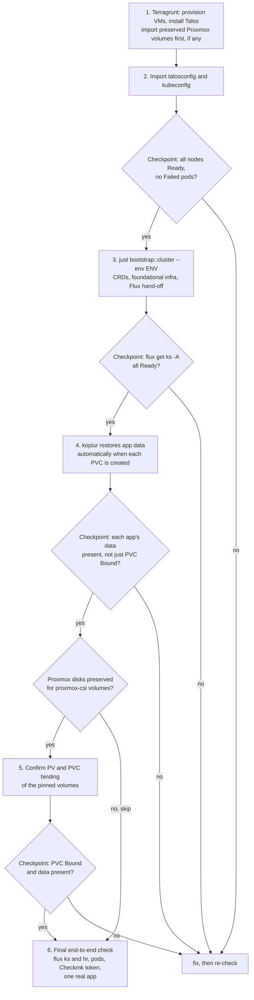

# Disaster recovery

This guide describes cluster recovery, not complete homelab recovery. The owner reports that the `rebuild` environment is torn down and reconstructed from Git on an irregular, roughly monthly cadence, with app data configured for kopiur backed up by that system. That exercises cluster recovery as `prod` evolves. Only the exercises listed under [Recorded rebuild exercises](#recorded-rebuild-exercises) have a recorded date, duration and result, and the sequence below is not a timed rehearsal record. The cluster's recovery boundary should not be confused with full homelab recoverability: some out-of-cluster components are incompletely documented or backed up, and secrets maintained in 1Password have no periodic backup. This follows up on [finding F8](audits/2026-09-documentation.md#f8--backup-documentation-should-emphasize-restore-capability), which called for clear verification status.

## Recovery scenarios

| Scenario | Mechanism | Recovery status |
| --- | --- | --- |
| Whole cluster lost (Proxmox VMs, Talos, Kubernetes all gone) | [Full cluster rebuild](#full-cluster-rebuild) below | Exercised periodically in `rebuild` on an irregular, roughly monthly cadence; not timed or recorded here for each run |
| In-cluster app data lost (PVC deleted/corrupted, cluster otherwise fine) | [`kopiur-backup-restore.md`](kopiur-backup-restore.md#restore-an-app-from-its-latest-backup) | Yes — validated live in `rebuild` with a disposable test app |
| A single Proxmox VM/LXC lost (not the whole cluster) | [`proxmox-backup-restore.md`](proxmox-backup-restore.md) | Yes — a live restore-to-new-VMID was validated end to end (see that doc's Live-tested record) |
| A `proxmox-csi` volume's data needs to survive the rebuild below | [`storage.md`](architecture/storage.md#proxmox-csi--terragrunt-pinned-volumes-that-survive-a-cluster-rebuild) | Yes — this is the property proxmox-csi is specifically kept for |
| Root-zone DNS (the two LXC nameservers) lost | Outside this repo entirely — see [`network.md`](architecture/network.md#physical-network-opnsense-ucs-and-the-root-nameservers) | Not covered here |
| 1Password-held secrets unavailable | Secrets are sourced from 1Password for bootstrap and External Secrets Operator; see [`secrets.md`](architecture/secrets.md#1password--external-secrets-operator--for-secrets-sourced-live-from-a-vault) | No periodic backup is maintained; recovery procedure is not documented here. Tracked in [#1636](https://github.com/isejalabs/homelab/issues/1636) |

## Recovery boundaries outside the cluster

The cluster rebuild does not restore every service the homelab depends on. This is an initial inventory from the repository's documentation, not a complete inventory of every physical or external dependency:

| Dependency | Role and source documentation | Recovery / backup coverage |
| --- | --- | --- |
| Proxmox hosts | Host the cluster VMs; this repo provisions VMs through Terragrunt, but not the physical Proxmox hosts | Host-level recovery and backup coverage are not documented here |
| TrueNAS S3 NAS (`fiona`) | Stores the S3-compatible kopiur repositories; see [`kopiur-backup-restore.md`](kopiur-backup-restore.md#overview) | App data configured for kopiur is backed up to this NAS; recovery or independent backup of the NAS itself is not documented here |
| OPNsense routers and UCS servers | External routing, DHCP, identity, and DNS dependencies described in [`network.md`](architecture/network.md#physical-network-opnsense-ucs-and-the-root-nameservers) | Configuration recovery and backup coverage are not documented here |
| Root-zone DNS LXCs | Authoritative DNS for `iseja.net`, described in [`network.md`](architecture/network.md#physical-network-opnsense-ucs-and-the-root-nameservers) | Recovery procedure is not documented here |
| 1Password vault | Holds secrets used by bootstrap and External Secrets Operator; see [`secrets.md`](architecture/secrets.md#1password--external-secrets-operator--for-secrets-sourced-live-from-a-vault) | The owner reports no periodic backup of vault secrets; recovery procedure is not documented here. Tracked in [#1636](https://github.com/isejalabs/homelab/issues/1636) |

These are known boundaries, not a claim that no external backups exist. Where this guide says coverage is not documented, confirm the actual protection and restore method before relying on it.

## Full cluster rebuild

Six steps, each citing the doc that owns it. Run them in order; don't skip a validation checkpoint to save time — a problem caught at step 2 is much cheaper to fix than the same problem discovered at step 6.

The checkpoint after step 2 also covers step 1, because Terragrunt reporting success does not prove the cluster is usable. A failed checkpoint is resolved before the next step starts, which is the point of the order.

### 1. Provision VMs and install Talos

[`terragrunt/README.md`](../terragrunt/README.md#plan-and-apply-a-unit) — `terragrunt plan`/`apply` from the environment's `vehagn-k8s` module directory, the `.envrc`/`TG_IAM_ASSUME_ROLE` direnv gotcha, and the `prod`/`qa` main-branch-only rule.

**If recovering from a teardown that preserved Proxmox volumes** (rather than a from-scratch provision): import the surviving disk(s) first — see [`terragrunt/README.md`](../terragrunt/README.md#import-proxmox-volume)'s import commands, which need the Proxmox volume's node/storage path from before the teardown.

**Checkpoint**: don't proceed until the next step's own checks (below) pass — Terragrunt reports success at the infrastructure level, but the node/pod-readiness check is the real signal the cluster is actually usable.

### 2. Import cluster access configs

[`terragrunt/README.md`](../terragrunt/README.md#import-configs) — merge the fresh `talosconfig`, generate a `kubeconfig`. Remove any stale context for the same cluster name first if this is a rebuild of an already-known environment (same doc, ["Remove existing contexts from config"](../terragrunt/README.md#remove-existing-contexts-from-config)), or `kubectl config get-contexts` will show a confusing `-1`-suffixed duplicate.

**Checkpoint**: [`k8s/bootstrap/README.md`](../k8s/bootstrap/README.md#preliminary-checks)'s preliminary checks — `kubectl get nodes -A -o wide` (all nodes `Ready`), then `kubectl get pods -A --field-selector=status.phase=Failed` (expect none). Don't move to step 3 until both are clean.

### 3. Bootstrap CRDs, foundational infra, and hand off to Flux

[`k8s/bootstrap/README.md`](../k8s/bootstrap/README.md) — `just bootstrap::cluster --env <env>`. This installs Cilium, sealed-secrets, cert-manager, the Flux operator/instance (see [`workloads.md`](architecture/workloads.md#bootstrap-install-order) for the exact dependency chain), then hands reconciliation off to Flux for everything else.

**Checkpoint**: the same doc's own `flux get ks -A` check — every `Kustomization` should reach `READY=True` within a few reconcile intervals (see [`environments.md`](architecture/environments.md#2-how-updates-land) for how long that takes per environment). A `Kustomization` stuck `False` here is a real problem to resolve before continuing, not something later steps will fix on their own.

### 4. Verify in-cluster app/PVC data restored automatically

No restore command needed here — this isn't an action step, just a checkpoint. Every app's PVC uses kopiur's CSI `dataSourceRef`/`Restore` populator (see [`kopiur-backup-restore.md`'s "Restore-on-create"](kopiur-backup-restore.md#restore-on-create-the-core-idea)), and step 3's Flux reconciliation creating each app's PVC fresh *is* the "full namespace recreation" case that mechanism already handles on its own: kopiur restores the latest matching snapshot before any pod can mount the volume, with no explicit restore command. This exact automatic-restore-on-create path is what the disposable `kopiur-test` app validated live in `rebuild` (see the scenarios table above) — not the manual recipe below.

**Checkpoint**: confirm each app's data is actually *present*, not just that its PVC is `Bound` — a PVC whose `Restore` found no matching snapshot still binds successfully (`onMissingSnapshot: Continue` populates an empty volume instead of blocking forever), which looks identical to a successful restore at the PVC level. [`kopiur-backup-restore.md`'s manual restore recipe](kopiur-backup-restore.md#restore-an-app-from-its-latest-backup) (`just backup::kopiur::restore <app> -e <env> -n <namespace>`) is only needed if this checkpoint fails for a specific app — not part of the normal rebuild sequence.

### 5. Re-attach any `proxmox-csi`-pinned volumes

Only relevant if step 1's teardown deliberately preserved Proxmox-side disks for a `proxmox-csi` volume (see the scenarios table) rather than a from-scratch provision — the import happened in step 1, but the Kubernetes-side `PersistentVolume`/`PersistentVolumeClaim` binding is worth confirming explicitly here, once the app that claims it is actually running (step 3/4 may have already recreated it). See [`storage.md`](architecture/storage.md#proxmox-csi--terragrunt-pinned-volumes-that-survive-a-cluster-rebuild) for which volumes this applies to today.

**Checkpoint**: `kubectl get pvc -A` shows the volume `Bound`, and the app using it has its data (the same check as step 4, for the proxmox-csi case instead of the kopiur-backed case).

### 6. Final end-to-end check

No single existing doc covers this, since it's specific to "is the whole homelab actually back," not any one subsystem:

- `flux get ks -A` and `flux get hr -A` — everything `READY=True`, nothing `SUSPENDED`.
- `kubectl get pods -A --field-selector=status.phase!=Running` — nothing unexpected (completed Jobs are fine, see [`k8s/bootstrap/README.md`](../k8s/bootstrap/README.md#preliminary-checks)).
- Checkmk: a recreated cluster has a new service-account token, so the token stored in Checkmk's password store is stale and the cluster's Kubernetes special agent fails with `401 Unauthorized` on `/version`. Refresh it as described in [`checkmk-agent`'s README](../k8s/apps/monitoring/checkmk-agent/README.md#refresh-the-token-after-a-cluster-is-recreated). This hits `rebuild` every time it is reconstructed.
- Spot-check at least one real, user-facing app end to end (e.g. a DNS query against AdGuard, or opening Actual Budget) — a clean `flux`/`kubectl` status doesn't guarantee the app is actually usable.

## Recorded rebuild exercises

### 2026-10-30/31, `rebuild`: cold start of the Keycloak unit ([#2012](https://github.com/isejalabs/homelab/issues/2012))

A from-scratch recreate of `rebuild` (destroy, `terragrunt apply`, `initial` snapshot, `just bootstrap::cluster --env rebuild`, Flux), run to check that the `keycloak` unit converges in order after [#1940](https://github.com/isejalabs/homelab/issues/1940) when the CRDs, the StorageClass and the Gateway are created at the same time. **Link state:** the home internet download speed was degraded (a 50 MB test download from the build Mac ran at about 32 KB/s at the start; image pulls on the nodes ran at roughly 0.2 to 1 MB/s and improved during the run), so the durations below are not comparable with the one-hour rebuild target.

| Phase | Start (UTC) | Duration | Notes |
| --- | --- | --- | --- |
| Destroy (27 resources) | 2026-10-30 05:29:57 | 1 min | `scripts/tg-state-rm.sh`, then `terragrunt plan -destroy -refresh=false` and apply |
| `terragrunt apply` (VMs, Talos, Cilium bootstrap) | 2026-10-30 05:32:15 | 31 min 47 s | Talos image download to three Proxmox hosts 8.5 min; three applies (locked SSH agent, then the 10 min `talos_cluster_health` timeout while the control plane images were still pulled) |
| `initial` snapshot | 2026-10-30 06:04:35 | 1 min | |
| `just bootstrap::cluster` | 2026-10-30 06:06:15 | about 19 min in five runs | Helm waits for Cilium and external-secrets (5 min) timed out on pulls; waiting for the 1Password CLI between runs is not counted; finished 2026-10-31 15:50:25 |
| Flux hand-off until every `Kustomization` is `Ready` | 2026-10-31 15:50:20 | 77 min 21 s | about 22 min of it a stall until eight stalled HelmReleases were reconciled by hand, see below |
| `keycloak`: first apply until `Ready` | 2026-10-31 16:31:08 | 16 min 50 s | `Kustomization` created at 15:50:20, waited in `DependencyNotReady` for `cloudnative-pg` |

Without waits for the 1Password CLI the active time was about 2 h 10 min. **Image pulls:** in the Flux phase 80 pulls took 296 node-minutes in total, and at least one pull was in flight for 35.8 of the 77.3 minutes (46%). On the critical path of `keycloak` the `cloudnative-pg` image (1 min 27 s) and the PostgreSQL image (6 min 24 s) took about 8 of the 16 min 50 s before `initdb` could start.

**Result for the Keycloak unit:** the events of the `keycloak` `Kustomization` contain only `DependencyNotReady`, `Progressing` and `ReconciliationSucceeded`; no event of any `Kustomization` in the whole bring-up reported a missing CRD (`no matches for kind`), StorageClass or Gateway. The Keycloak pod restarted twice by its liveness probe while the database image was still being pulled, and the operator then recreated it.

**What did not converge by itself** (follow-ups, all under [#1937](https://github.com/isejalabs/homelab/issues/1937)):

- HelmReleases stay `Stalled` after one install that ran into the Helm timeout, which blocked `keycloak` through `cloudnative-pg` until `flux reconcile hr --reset --force`: [#2045](https://github.com/isejalabs/homelab/issues/2045). Addressed by enabling helm-controller's `DefaultToRetryOnFailure` feature gate in [`flux-instance`](../k8s/infra/flux-system/flux-instance/base/helmrelease.yaml), see [`troubleshooting-flux.md`](troubleshooting-flux.md#4-helmrelease-specific-gotcha-readytrue-doesnt-always-mean-live-state-matches-git); not yet confirmed by a repeat of the cold start.
- `powerdns` and `actualbudget` failed their dry-run on a kopiur webhook until the `ClusterRepository` existed: [#2046](https://github.com/isejalabs/homelab/issues/2046).
- Cilium is installed twice (module 1.18, base 1.19), so every node pulls both generations of images: [#2044](https://github.com/isejalabs/homelab/issues/2044).

A repeat with a normal internet link is still open.

## What this doesn't cover yet

- Root-zone DNS recovery if both LXC nameservers are lost — physical infrastructure with no representation in this repo at all (see [`network.md`](architecture/network.md#physical-network-opnsense-ucs-and-the-root-nameservers)).
- A complete inventory and recovery plan for out-of-cluster components. The repository does not yet document which external dependencies are fully backed up and restorable.
- Recovery of 1Password-held secrets: there is no periodic backup, and this guide does not define how to restore or recreate those vault items.
- A dated, timed record for every `rebuild` exercise — the cadence and scope above are owner-reported, and only the exercises under [Recorded rebuild exercises](#recorded-rebuild-exercises) have their results recorded.
