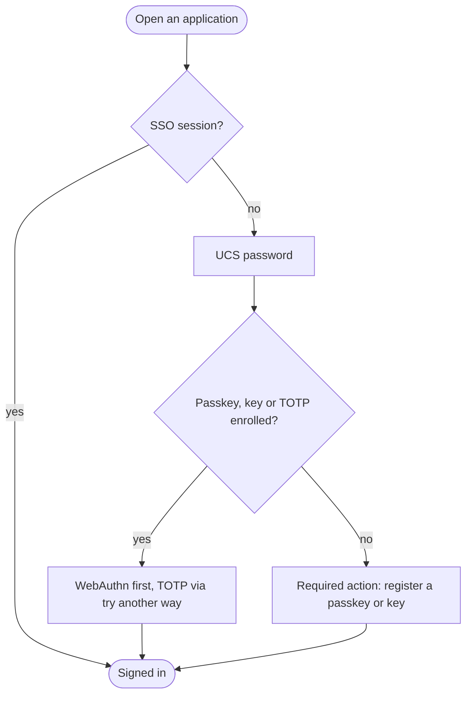

# Second factor in the Keycloak realms

**Choose a task:** enroll a factor under [Enroll](#enroll); a lost authenticator under [Lost authenticator](#lost-authenticator); why a hostname change breaks enrolled keys under [Relying-party ID](#relying-party-id).

**On this page:** [Policy](#policy) · [Relying-party ID](#relying-party-id) · [How the login works](#how-the-login-works) · [Enroll](#enroll) · [Lost authenticator](#lost-authenticator) · [Break-glass and lockout](#break-glass-and-lockout) · [Verified and not verified](#verified-and-not-verified) · [Open points](#open-points)

## Policy

Decisions D4 and D5 of the [design plan](../plans/2026-10-identity-claude.md) and [ADR 0016](../decisions/0016-identity-and-web-sso.md), point 5, made concrete by the Terragrunt unit [`keycloak-realm`](keycloak-realms.md) (realm configuration in [`terragrunt/_envcommon/keycloak-realm.hcl`](../../terragrunt/_envcommon/keycloak-realm.hcl), flow in the module [`keycloak-realm`](https://github.com/isejalabs/terraform-modules/tree/main/modules/keycloak-realm) of `isejalabs/terraform-modules`):

| Realm | After the UCS password | Fallback | Enrollment |
| --- | --- | --- | --- |
| `admin` (`*-adm` accounts) | A WebAuthn authenticator: a passkey (for example in 1Password) or a security key (YubiKey), always with user verification (PIN or biometric) | TOTP code | Passkey or key, registered at the first login |
| `iseja` (everyday accounts) | A passkey, a security key or a TOTP code, whichever the user has set up | none needed, any of the three is enough | Passkey or key, registered at the first login |

- The password stays a UCS password, so UCS stays authoritative: disabling or locking the account in UCS ends all access, whatever factors are enrolled. Not passwordless, on purpose.
- If the `sebi-adm` password, passkey and TOTP seed all live in 1Password, the factors collapse into "access to the vault". A YubiKey enrolled **in addition** keeps one factor outside it, so enroll one.
- Until Kerberos SSO exists ([#1827](https://github.com/isejalabs/homelab/issues/1827)) every login to `iseja` is a password login, so the second factor applies to all of them. The Kerberos side (a valid ticket counts as sufficient, step-up for sensitive apps) is not part of this flow and does not weaken it for `admin`: that realm never accepts Kerberos.
- The `master` realm is not changed by any of this, see [Break-glass and lockout](#break-glass-and-lockout).

## Relying-party ID

A WebAuthn credential is bound to a **relying-party ID** (RP ID), a domain the browser checks against the page it is on. A credential registered for one RP ID is not valid for another. The realms did not set one; Keycloak derived it from the hostname of each request. It is now set explicitly in every realm, to the hostname of the environment's Keycloak URL:

| Environment | RP ID (both realms) |
| --- | --- |
| `dev` | `dev-auth.dev.iseja.net` |
| `qa` | `qa-auth.qa.iseja.net` |
| `prod` | `auth.iseja.net` (at the go-live, [#2196](https://github.com/isejalabs/homelab/issues/2196)) |

The module takes it from `keycloak_url`, so the value cannot drift from the hostname the users reach Keycloak on, and it can be overridden for the whole module (`web_authn.relying_party_id`) or per realm.

**Why the exact hostname and not a parent domain** such as `iseja.net`: a parent domain would let every host below it ask for these credentials, in `prod` all of `*.iseja.net`. Keycloak still verifies the origin, so that would not let another site log in, but it widens the exposure for no benefit today. Separate RP IDs per environment also keep a `dev` or `qa` credential from being valid in `prod`.

**What it costs:** changing the Keycloak hostname (or the RP ID) makes **every enrolled passkey and security key unusable** until it is enrolled again, and TOTP is unaffected. Plan a hostname change as a re-enrollment of all users, with [break-glass access](keycloak-break-glass.md) for the `admin` realm, or keep the old hostname as the RP ID by setting `web_authn.relying_party_id` before moving. The same holds when a database dump is restored into another environment ([restore](keycloak-backup-restore.md)): the keys in it belong to the source environment's RP ID.

## How the login works

The flow is `browser-mfa` in every realm that sets `second_factor`, and replaces the built-in `browser` flow as the realm's browser flow (the built-in one is left untouched, so removing `second_factor` restores it). A user who has any factor goes through the "verify" sub-flow; Keycloak offers setup only for a *required* authenticator, so a second sub-flow, which runs only when the first did not, requires the registration. An existing SSO session (cookie) skips the second factor until it expires, as for any Keycloak login.

## Enroll

The first login after the flow is active asks for the registration; nothing has to be done in advance.

### `sebi-adm` in the `admin` realm

Needs the owner's hands: the authenticators are physical or in the owner's 1Password.

1. Open the account console of the realm: `https://<keycloak host>/realms/admin/account` (dev: `https://dev-auth.dev.iseja.net/realms/admin/account`), sign in as `sebi-adm` with the UCS password.
2. Keycloak asks to register a security key or passkey. Choose the **1Password passkey** first (the browser offers to save it in 1Password), name it `1password`.
3. Sign out, sign in again: UCS password, then the passkey prompt. This is the first criterion.
4. Under *Account security* → *Signing in* → *Two-factor authentication* choose **Set up Passkey** again (Keycloak 26 labels every WebAuthn credential *Passkey*, there is no separate *security key* button). In the browser dialog pick the security key instead of 1Password (*Use a different device* / *Security key*; if 1Password keeps answering, dismiss its prompt or disable its passkey prompt for the page), touch the YubiKey. With user verification required, the key needs a PIN; Chrome and Safari offer to set one on first use. Name it `yubikey`, sign out and in with it.
5. Add **TOTP** (*Authenticator application*), scan the QR code with an authenticator app other than 1Password if the aim is to keep one factor outside the vault, and sign in once with *Try another way* → *Authenticator application*.

### An everyday account in the `iseja` realm

1. Sign in to any application that uses Keycloak, or open `https://<keycloak host>/realms/iseja/account`.
2. After the UCS password Keycloak asks to register a passkey or security key. A phone offers its own passkey; a computer offers 1Password, the browser's store or a key.
3. Under *Account security* → *Signing in* → *Two-factor authentication* add a second authenticator (*Set up Passkey*, then choose the key or device in the browser dialog) and, if wanted, TOTP (*Set up Authenticator application*), so one lost device does not lock the account.

## Lost authenticator

Which case applies depends on whether the user still has another factor.

| Situation | Who | Steps |
| --- | --- | --- |
| Another factor still works | The user | Sign in with it, then account console → *Signing in*: delete the lost authenticator, add a new one. |
| No factor works (`iseja`) | The owner | Sign in to the [`master` console](keycloak-break-glass.md#sign-in-to-the-admin-console), choose the realm, *Users* → the person → *Credentials*: delete the lost credential(s). At the next login the person is asked to register a new factor. |
| No factor works (`admin`, `sebi-adm`) | The owner, with the break-glass login | Same, in realm `admin`. The login of the `master` realm needs neither UCS nor any factor of the `admin` realm. |

Deleting a credential never touches the UCS password. If the lost authenticator may be in somebody else's hands, also change the UCS password and disable the account in UCS meanwhile; Keycloak does not need to be touched for that.

## Break-glass and lockout

Enforcing the second factor cannot lock the owner out of Keycloak itself:

- The `master` realm keeps its built-in flow and its local bootstrap administrator (`keycloak-bootstrap-admin#<env>`, see [break-glass](keycloak-break-glass.md)). No second factor is enforced on it ([open point](keycloak-break-glass.md#open-points)), and UCS is not involved in signing in to it.
- Terragrunt logs in with a service-account client in `master` (client-credentials grant), which has no browser flow, so applying or reverting the unit works even if no one can sign in to `iseja` or `admin`.
- A user without any factor is not locked out, the flow makes them register one. The failure mode is therefore a broken flow, not a missing factor: if the `browser-mfa` flow ever blocks logins, the owner signs in to `master` and sets the realm's *Authentication* → *Flows* → *Browser* binding back to the built-in `browser` flow, then removes `second_factor` in the unit.
- Applications that only trust `admin` (admin UIs) are unreachable through Keycloak meanwhile; their local logins (Proxmox, OPNsense, TrueNAS, RustFS, `talosctl`) are the break-glass list of [ADR 0016](../decisions/0016-identity-and-web-sso.md).

## Verified and not verified

| Statement | State |
| --- | --- |
| The module sets the RP ID, the flow and the binding, and rejects bad input | Verified offline (`tofu test` of the module) |
| The flow, its condition and the `browser-mfa` binding exist in the `dev` realms `iseja` and `admin`, RP ID `dev-auth.dev.iseja.net`, `admin` with user verification `required`; the following plan shows no changes | Verified 2026-11-07 (applied from the unreleased module branch, 28 added, 2 changed) |
| The flow against a throwaway Keycloak 26.8.1: a user without a factor gets the passkey registration after the password, a user with TOTP is asked for the code and signed in with it | Verified 2026-11-08 (scripted login; the first `dev` version failed every login and was fixed) |
| The same in the `dev` Keycloak with `sebi-adm` (UCS): no factor yet leads to the passkey registration | Verified 2026-11-08 (owner; the first two attempts failed on the flow bugs fixed in the module before) |
| `sebi-adm` signs in to `admin` with UCS password + 1Password passkey | Verified 2026-11-08 (owner; the passkey is stored in 1Password, one `webauthn` credential in the database, no login error in the Keycloak log) |
| `sebi-adm` signs in to `admin` with UCS password + TOTP, also in a fresh sign-in | Verified 2026-11-08 (owner) |
| `sebi-adm` signs in to `admin` with UCS password + hardware security key | **Not verified**: the owner's YubiKey NEO speaks only the older U2F protocol and cannot do user verification (PIN), which `admin` requires; to be repeated with a FIDO2 key |
| A password login in `iseja` asks for a factor, no path skips it: user `sebi` without a factor got the passkey registration straight after the password, then signed in with password + passkey | Verified 2026-11-08 (owner; one `webauthn` credential in the database; a user who already has a TOTP is asked for the code, see the throwaway-Keycloak row) |
| Lost-authenticator recovery for `sebi-adm`, first row of the table (another factor still works): the passkey was deleted in the account console, the next sign-in asked for TOTP, and a new passkey was registered | Verified 2026-11-08 (owner) |
| Lost-authenticator recovery, rows two and three (owner deletes the credentials in the `master` console) | **Not verified**: the `master` console lists no users in `iseja` or `admin` (the realms are LDAP-backed); whether a search finds them is open |
| Realm configuration plans without changes in `dev` with the released module `keycloak-realm-v0.5.0` | Verified 2026-11-08 (`No changes`) |
| `qa` plan with the released module | Plan 2026-11-08: 26 to add, 2 to change (RP ID, `admin` user verification), 0 to destroy, provider lock file unchanged; applied from `main` after the merge, then a following plan must show no changes: not verified yet |

## Open points

- **Hardware key must be FIDO2.** `admin` requires user verification, so a security key needs a PIN, which only FIDO2 keys (YubiKey 5 series, Security Key series and newer) support. Older U2F-only keys such as the YubiKey NEO cannot be enrolled in `admin`; Microsoft accounts reject them for the same reason. The key test of `sebi-adm` waits for such a key.
- **TOTP as the enrollment choice for everyday accounts.** The first login registers a passkey or key; TOTP is added by the user in the account console. The unit can require TOTP instead (`second_factor = { enroll = "totp" }`), for example for accounts on devices without passkey support. Keycloak offers no per-login choice between the two registrations.
- **Step-up for sensitive `iseja` apps** and Kerberos in the same flow: [#1827](https://github.com/isejalabs/homelab/issues/1827), sub-issue [#2211](https://github.com/isejalabs/homelab/issues/2211).
- **Recovery codes** (Keycloak's *Recovery Authentication Codes*) are not enabled. The owner's break-glass access is the recovery path.
