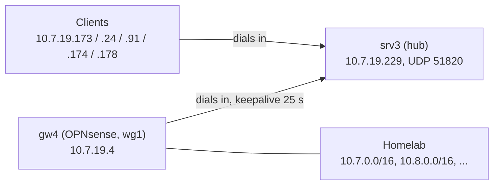

# WireGuard hub on srv3

Tracked in [#2132](https://github.com/isejalabs/homelab/issues/2132). The WireGuard server on the OPNsense gateway `gw4` (instance `wg1`, UDP 51819) is not reachable from the internet while the uplink is the LTE router of [#2042](https://github.com/isejalabs/homelab/issues/2042), which does not forward the port. The VPS `srv3.iseja.net` therefore runs the server instead: `gw4` and all remote clients connect to it. The network `10.7.19.0/24` stays, so the existing firewall rules and DNS entries keep working.

Neither `srv3` nor OPNsense is managed from this repository. `srv3` is configured by the role `wireguard_hub` of the private repository `isejalabs/ansible-iseja.net-codex` ([isejalabs/ansible-iseja.net-codex#5](https://github.com/isejalabs/ansible-iseja.net-codex/pull/5)); the `gw4` and client steps below are manual.

## Topology



- A client has exactly one WireGuard peer, `srv3`, so it routes the homelab through `10.7.19.229`, not through `10.7.19.4`. Its `AllowedIPs` already contain `10.7.0.0/16`, which covers `10.7.19.4` too.
- `srv3` sends the packets on to the `gw4` peer (the `AllowedIPs` of that peer are the homelab subnets) or to another client. Clients cannot reach each other or `gw4` directly, only through the hub.
- There is no NAT on `srv3`. The homelab sees the real `10.7.19.x` address of the client, which is why the existing rules for that network still match.
- `gw4` connects out with a keepalive, so the LTE router needs no port forward. Only VPN traffic uses the tunnel; the internet traffic of the homelab stays on the local uplink.
- All peers use MTU 1364 (the value of the existing client configurations); `srv3` clamps the TCP MSS to the tunnel MTU.

## Values

| What | Value |
| --- | --- |
| Endpoint | `srv3.iseja.net`, UDP `51820` |
| Hub tunnel address | `10.7.19.229/24` |
| Hub public key | `glox4kPPlHm0c6Rs7AWBFolQ9O6XdpbhVypvW/E4+Qw=` |
| `gw4` tunnel address and public key | `10.7.19.4/24`, `zXMIhVYYgfFxoGK1G9kJ1lPDsvImaOg0wuw8dj8n0wc=` (unchanged: `wg1` keeps its key) |
| Peers on the hub | `gw4` and five clients (`10.7.19.173`, `.24`, `.91`, `.174`, `.178`); the list is `inventory/group_vars/wireguard_hubs.yml` in the Ansible repository |
| Homelab subnets routed to `gw4` | `10.7.0.0/16`, `10.8.0.0/16`, `10.1.1.1/32`, `10.9.9.9/32`, `10.19.19.0/24`, `192.168.8.0/24`, `192.168.2.0/24` |

The private key of `srv3` exists only on the host (`/etc/wireguard/wg0.key`). Public keys are not secrets.

## Apply or change the hub

From the Ansible repository:

```sh
ansible-playbook -i inventory/hosts.example.yml playbooks/wireguard.yml --check --diff
ansible-playbook -i inventory/hosts.example.yml playbooks/wireguard.yml
```

To add a client, append it to `wireguard_hub_peers` in `inventory/group_vars/wireguard_hubs.yml` (its public key and its `/32`) and run the playbook again. A change of the peer list restarts `wg0` on `srv3`, which interrupts the tunnels for a moment. The firewall allows SSH, UDP 51820 and ICMP in; everything else is dropped.

## Convert `gw4` into a client

Menu names are those of OPNsense 24.7 and later (VPN → WireGuard → Instances / Peers); adapt them if your version differs. Keep the instance `wg1` and its interface assignment: the firewall rules are bound to the interface, so they stay valid.

1. Save a configuration backup (System → Configuration → Backups). This is the rollback.
2. Edit the instance `wg1`: keep the key pair, set the tunnel address `10.7.19.4/24`, MTU `1364`, and clear the listen port (the instance dials out). This ends the server role: clients that still connect to `gw4` directly stop working, which is the situation anyway while the LTE router blocks the port.
3. Add a peer `srv3`: public key of the hub (table above), endpoint address `srv3.iseja.net`, port `51820`, allowed IPs `10.7.19.0/24`, keep alive `25`.
4. In the instance, make `srv3` the only peer: remove the old client peers or disable them, because they now live on `srv3`. Save and apply.
5. Check the firewall rules of the `wg1` interface: they must still allow what the clients are allowed today. The WAN rule for UDP 51819 is no longer needed and can be removed once all clients are switched.

## Switch a client

In the client configuration, change only the `[Peer]` section; `Address`, `DNS`, `MTU` and `AllowedIPs` stay as they are:

```ini
[Peer]
PublicKey = glox4kPPlHm0c6Rs7AWBFolQ9O6XdpbhVypvW/E4+Qw=
AllowedIPs = 10.7.0.0/16, 10.8.0.0/16, 10.1.1.1/32, 10.8.8.8/32, 10.9.9.9/32, 10.19.19.0/24, 192.168.8.0/24, 192.168.2.0/24
Endpoint = srv3.iseja.net:51820
PersistentKeepalive = 25
```

A client at home also goes through `srv3` now (a detour over the internet). Disconnect it while on the home network; the LAN is reachable without the tunnel.

## Verify

On `srv3`:

```sh
wg show wg0            # a recent "latest handshake" for gw4 and for each switched client
ping -c 3 10.7.19.4    # gw4 through the tunnel
```

From a switched client:

```sh
ping -c 3 10.7.19.229  # the hub
ping -c 3 10.7.19.4    # gw4, through the hub
ping -c 3 10.7.8.1     # the standard gateway of the homelab
dig @10.8.8.8 adguard.prod.iseja.net
```

To confirm that the source address is preserved, capture on `gw4` (Interfaces → Diagnostics → Packet Capture, interface `wg1`, or the live log of the firewall rule) while the client pings `10.7.8.1`: the source must be the client's `10.7.19.x`, not `10.7.19.229`.

## Roll back

1. On `gw4`, restore the configuration backup of step 1 (or turn `wg1` back into a server with listen port `51819` and the old peers).
2. In each client, restore the old `[Peer]` section (`PublicKey = zXMIhVYYgfFxoGK1G9kJ1lPDsvImaOg0wuw8dj8n0wc=`, `Endpoint = vpn.iseja.net:51819`). This only works while the port is reachable from the internet.
3. `srv3` can stay up; with no peer connecting, it does nothing.

## Open points

- The cable line is still down ([#2042](https://github.com/isejalabs/homelab/issues/2042)). Once it is repaired, decide whether to keep the hub (independent of the home uplink, one more hop) or return to the server on `gw4`.
- `srv3` accepts SSH on the public address, with the password method still enabled in `sshd`. Hardening the SSH daemon is not part of the `wireguard_hub` role.
- While the LTE router is the uplink, the tunnel from `gw4` to `srv3` runs through its carrier NAT; the keepalive of 25 s keeps the mapping open.
