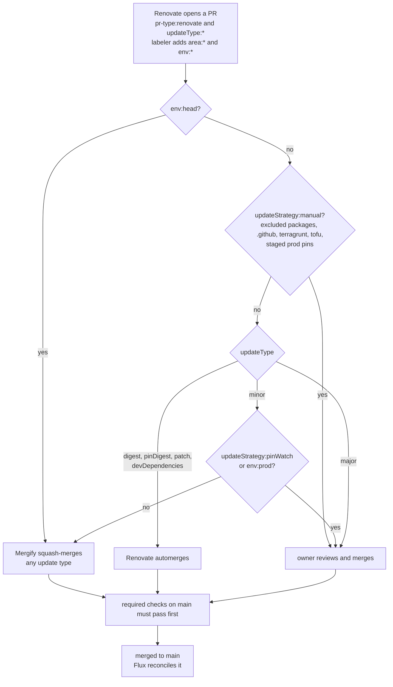

# Update Handling and Automerging of PRs

See [`docs/architecture/environments.md`](architecture/environments.md) for what each environment is for and how they differ structurally (sizing, which apps run, Flux reconciliation interval, ...). This doc only covers how *package-update* PRs get created, labeled, and merged — and, separately, how a Flux instance decides what ref to reconcile from in the first place.

## Overview

### Toolchain

- **renovate**: creates PRs for package/dependency updates, labels them, and automerges some of them based on update type and per-package/per-path rules (see [`.github/renovate.json5`](../.github/renovate.json5) and [`.github/renovate/`](../.github/renovate/)).
- **labeler**: labels PRs from the paths they touch — `env:<env>` from which `k8s/**/envs/<env>/**` or `terragrunt/*/*/<env>/**` paths changed, `area:*` from which top-level folder changed (see [`.github/labeler.yml`](../.github/labeler.yml)). These labels describe *what a PR touches*, not who it's "for" — a PR only gets `env:prod` because it happens to edit something under an `envs/prod/` folder.
- **mergify**: merges PRs automatically based on the labels above (see [`.github/mergify.yml`](../.github/mergify.yml)).
- **Flux CD**: reconciles every environment's cluster continuously from Git — normally `refs/heads/main`. There is no separate "apply to the cluster" step distinct from merging: once a PR lands on `main`, Flux picks it up on its next reconcile (see [`kustomize.md`](architecture/kustomize.md) and [`environments.md`](reference/environments.md#flux-reconciliation-interval) for the per-environment interval). This replaces an earlier draft of this doc that referenced Argo CD — **this repo has never used Argo CD**; Flux is the only GitOps controller here.

#### Labels

- `pr-type:renovate`: the PR was created by renovate (as opposed to a manual PR, which carries no `pr-type` label).
- `updateType:digest`, `updateType:pinDigest`, `updateType:patch`, `updateType:minor`, `updateType:major`: the kind of update.
- `updateStrategy:manual`: excluded from automerging — critical packages, or paths that always need review (`.github/**`, `terragrunt/**`, `tofu/**`).
- `updateStrategy:pinWatch`: this package is pinned to an older version everywhere *except* `head`/`poc` (which track the newest release as a "watch" for when it's safe to unpin elsewhere) — see [Non-standard update strategies](#non-standard-update-strategies).
- `env:head`, `env:qa`, `env:dev`, `env:prod`, `env:dbg`, `env:poc`, `env:rebuild`, `env:src`, `env:base`: which overlay path(s) the PR touches (lowercase — matching the actual labeler config, not the `env:PROD` casing an earlier draft of this doc used).
- `area:terraform`, `area:k8s`, `area:docs`, `area:ci`, `area:ai`: which top-level folder the PR touches.

## How environments actually differ for update handling

Every environment's Flux instance reconciles continuously from Git — there's no per-environment "who applies it" split the way an earlier draft of this doc described (an "argo-cd" bucket vs. a "manual" bucket). What actually varies per environment is:

1. **Which git ref Flux reconciles from.** Normally `main`, for every environment. The one deliberate exception is `dev`, which is frequently pointed at whatever feature branch is currently under development instead — via the [`track-branch`](../.agents/skills/track-branch/SKILL.md) skill — so a change can be validated live before it's merged. Once pointed at a branch, Flux reconciles from it just as automatically as it would `main`; the only "manual" part is the decision to point it there (and back) in the first place, not the ongoing reconciliation. (An earlier draft of this doc listed `dev` as config-applied "manually" — that's the part this corrects.)
2. **Whether a renovate PR touching that environment's overlay gets automerged**, per the mergify rules below.
3. Everything else that differs per environment (sizing, which apps run at all, reconciliation interval) is architectural, not update-handling-specific — see [`environments.md`](architecture/environments.md#what-each-environment-is-for).

## Detecting package updates

### renovate

Upstream manifests that have no chart (the Gateway API CRDs, kubelet-serving-cert-approver, the Keycloak operator, Longhorn's uninstall job) are vendored under a `vendor/` directory of their unit, so that Flux's `kustomize build` never fetches them from the internet (an outage would otherwise fail the unit; see [#2055](https://github.com/isejalabs/homelab/issues/2055)). The unit's `kustomization.yaml` names the upstream file in a comment directly above the `vendor/` entry, and the `customManagers` in [`renovate.json5`](../.github/renovate.json5) match that URL, so Renovate still opens the version-bump PR. Renovate only changes the URL: run `scripts/vendor-manifests.sh update` on that PR branch to fetch the matching file, because the `kustomize-build` check (`scripts/vendor-manifests.sh check`) fails until the vendored file equals the upstream one. Hand-edits of a vendored file are not possible for the same reason; changes to it belong in a `patches:` entry of the unit.

Renovate creates one PR per package/update-type combination (`separateMinorPatch: true`), labeled `pr-type:renovate` plus an `updateType:*` label. Because `env:*` labels come from changed paths, a renovate PR that only touches `k8s/apps/foo/envs/prod/` (see [below](#tracking-a-version-separately-per-environment)) gets `env:prod` on its own, distinct from a PR touching `base/` (which affects every environment that doesn't override it) or another environment's own override.

## How a Renovate pull request gets merged

The decision order below is what the rules in [Automatic merging rules](#automatic-merging-rules) and [Excluded packages and paths](#excluded-packages-and-paths-from-auto-merging) add up to. The text sections are authoritative; the diagram only puts them in order, and must be updated together with `mergify.yml` and the Renovate rules.



## Merging PRs for package updates

### Automatic merging rules

Automerging only ever applies to `pr-type:renovate` PRs — a human-authored PR never automerges.

- **renovate** (`automerge-enable.json5`) automerges `digest`, `pinDigest`, and `patch` updates, and `devDependencies` updates (this repo has no application source code, so that category rarely applies in practice).
- **mergify** (`.github/mergify.yml`) automerges on top of that:
  ```yaml
  - name: Automatic Merge for HEAD environment
    conditions:
      - label=pr-type:renovate
      - label=env:head
  - name: Auto-Merge minor unless flagged for updateStrategy:manual, :pinWatch or env:prod
    conditions:
      - label=pr-type:renovate
      - label=updateType:minor
      - label!=updateStrategy:manual
      - label!=updateStrategy:pinWatch
      - label!=env:prod
  ```
  `env:head` automerges *unconditionally* — any update type, any area, even ones normally excluded by `updateStrategy:manual`. Every other environment gets `minor` updates automerged unless the PR is flagged `updateStrategy:manual`/`:pinWatch`, or carries `env:prod` (see next section for why prod is carved out here specifically, rather than every non-head environment being equally eligible).

Note `automergeType: "branch"` is set in `automerge-enable.json5` (renovate merging its own branch directly rather than opening a PR first), but this isn't actually happening in practice — PRs are still created for every automerge-eligible update. This is a known, unresolved discrepancy (see [Pending](#pending)), not a misconfiguration this doc can currently explain away.

### Tracking a version separately per environment

Any app's `envs/<env>/kustomization.yaml` can `patches:` its own chart's `OCIRepository`/`HelmRelease` version, completely independent of `base/` — the same generic per-environment override mechanism described in [`kustomize.md`](architecture/kustomize.md), applied to a version pin instead of an LB IP or replica count. Most apps never do this and simply inherit whatever `base/` pins. Two apps in this repo currently do, and both illustrate the point cleanly:

- **cilium** — `k8s/infra/kube-system/cilium/envs/head/ocirepository.yaml` patches its own `ref.tag`/digest to a newer release (`1.20.1` vs. `base`'s `1.18.13`, at time of writing), while `envs/prod/ocirepository.yaml` also exists as its own separate patch but currently pins the *same* version as `base` (`1.18.13`).
- **longhorn-core** — `k8s/infra/longhorn-system/longhorn-core/envs/prod/helm-version.yaml` similarly patches its own `HelmRelease.spec.chart.spec.version`, again currently matching `base`.

This is the mechanism issue-tracked as "an app can track a version in prod separately, on an optional basis": **most often prod's own patch is identical to `base` (and therefore to `qa`, which also inherits `base`)** — the override exists in the file tree but isn't being used to diverge from anything. Its value shows up the moment someone *wants* to diverge: because `envs/prod/ocirepository.yaml` is its own file, renovate treats a version bump there as its own package instance with its own PR, separate from the PR that bumps `base/`'s (and therefore `qa`'s) version. That PR picks up `env:prod` from labeler (it touches `k8s/**/envs/prod/**`), and the mergify rule above explicitly excludes `env:prod` from automerge — so it always needs a human to merge it. Concretely: `base`/`qa` can pick up a new version automatically (if it's a `minor` update) or via manual review, get it validated running in `qa` for however long is wanted, and only then merge the equivalent prod-specific PR to promote it — without prod ever being forced onto a new version the moment `base` moves, and without needing a repo-wide freeze to hold prod back.

#### Staged rollout: unbound

`docker.io/madnuttah/unbound` uses this mechanism *plus* an age gate, so prod trails `qa` by a fixed soak time ([#1882](https://github.com/isejalabs/homelab/issues/1882)):

- `k8s/apps/dns/unbound/base/deployment.yaml` pins the image for every environment except prod, and takes new releases immediately.
- `k8s/apps/dns/unbound/envs/prod/deployment.yaml` pins its own copy of the image (tag + digest). It is identical to `base/` except while an upgrade is in flight.
- [`staged-rollout.json5`](../.github/renovate/staged-rollout.json5) sets `minimumReleaseAge: "3 days"` for the `envs/prod/` file only. With `internalChecksFilter` at its default `strict`, Renovate opens no prod PR until a release is at least 3 days old.

Limitations:

- The 3 days count from the **upstream release date**, not from when `qa` deployed the version. If the `base/` PR is left unmerged, prod still gets its PR.
- A broken release is not stopped automatically. If `qa` shows a release is bad, close the prod PR (Renovate won't recreate it for that version) or exclude the version with `allowedVersions`.
- Whether digest-only updates (same tag, rebuilt image) are delayed too depends on the datasource providing a release timestamp. Not verified yet; check the first prod digest PR after merge.

#### Staged rollout: Keycloak and CloudNativePG

The units registered through [`sets/soaking`](../k8s/bootstrap/cluster/flux/sets/soaking/kustomization.yaml) (CloudNativePG operator, Keycloak operator, Keycloak and its database) are gated by `qa` the same way, with a stricter prod step because every SSO login depends on the `prod` instance ([ADR 0016](decisions/0016-identity-and-web-sso.md), [#1947](https://github.com/isejalabs/homelab/issues/1947)).

What `soaking` does and does not gate: the set only decides **which environments run the units**. It says nothing about **which versions** they run. Without the pins below, a unit that moves into `prod` follows `base/` exactly like `qa`, so a patch or digest update (automerged by Renovate) or a minor update (automerged by mergify) would reach `prod` the moment it lands on `main`, with no `qa` soak in between.

The policy, once a unit is promoted to `prod`:

- `base/` keeps taking releases as before, so `dev`, `qa` and `rebuild` run a new version first.
- `prod` pins every version of the unit itself under `envs/prod/` (see the checklist below). A bump there is its own PR, labeled `env:prod` by the labeler.
- The [`staged-rollout.json5`](../.github/renovate/staged-rollout.json5) rule for these `envs/prod/` paths sets `minimumReleaseAge: "7 days"`, `automerge: false` and the `updateStrategy:manual` label. The owner merges the PR after checking the version ran in `qa`.

The rule matches nothing yet: `prod` does not run these units, so there are no pin files. It starts to work when the promotion PR adds them. That PR must, besides moving the unit's line out of `sets/soaking`:

- [ ] Pin every version source of the unit in `envs/prod/` with the same value `base/` has at that moment: the chart tag and digest of the CloudNativePG `OCIRepository` (as in [cilium's `envs/prod/ocirepository.yaml`](../k8s/infra/kube-system/cilium/envs/prod/ocirepository.yaml)), the PostgreSQL image of the `Cluster` (once it is pinned, [#1941](https://github.com/isejalabs/homelab/issues/1941)) and of the dump job, and the Keycloak operator release.
- [ ] Give the Keycloak operator release a prod-owned pin. Its version is part of the upstream URLs in the comments of [`base/kustomization.yaml`](../k8s/infra/keycloak/keycloak-operator/base/kustomization.yaml), next to the manifests vendored under `base/vendor/`, which an overlay cannot patch, so the promotion PR has to decide how `prod` carries its own copy (for example a `vendor/` directory under `envs/prod/`, declared the same way and kept in sync by `scripts/vendor-manifests.sh`).
- [ ] Render the `prod` overlay before and after (`kubectl kustomize`) and check the output is unchanged apart from the promotion itself.

Limitations:

- The 7 days count from the **upstream release date**, not from when `qa` ran the version, as for unbound. The manual merge is what ties `prod` to a version that has actually run in `qa`.
- Renovate's default `minimumReleaseAgeBehaviour` is `timestamp-required`: a version whose datasource provides no release timestamp never counts as old enough, so no prod PR opens for it. That fails closed, but it can stall silently; check the Dependency Dashboard if a prod PR is missing a week after a release. Not verified per datasource yet, check the first prod PRs after promotion.

## Handling special apps and environments

Some packages have a non-standard update strategy — see the table below. Two environments also get special treatment baked into the mergify/renovate rules themselves, beyond the generic `env:prod` carve-out above (a full description of each environment's purpose lives in [`environments.md`](architecture/environments.md#what-each-environment-is-for); this section covers only the update-handling-specific behavior):

- **`head`** automerges every update unconditionally (see [above](#automatic-merging-rules)), and [`pin-versions.json5`](../.github/renovate/pin-versions.json5) exempts it from the repo-wide version pins on `cilium`/`gateway-api`/`kubernetes/kubernetes`/`mongo` — so it's the one environment that always tracks the newest available version of those packages, functioning as an early-warning signal for breakage before it reaches anywhere else.
- **`poc`** shares that same pin exemption (also tracking the newest version of those four packages) but is *not* automerged — its renovate PRs are deliberately left open as a standing "reminder" that a newer version exists, labeled `updateStrategy:pinWatch`, rather than landing automatically like `head`'s.

### Non-standard update strategies

| Package | Update strategy | Description |
| --- | --- | --- |
| `quay.io/cilium/charts/cilium` | Pin previous minor, manual | Pinned to the previous minor (`<=1.18`) for stability — a critical cluster component where even `patch` updates have caused issues before (e.g. [#725](https://github.com/isejalabs/homelab/issues/725)); `head`/`poc` track `>=1.18` instead, labeled `updateStrategy:pinWatch`. |
| `ghcr.io/cloudnative-pg/postgresql` | Manual | The Keycloak database image, pinned in `Cluster.spec.imageName` and copied into the dump job; every tag or digest update is a PR that waits for a human, since it restarts the database (and a major one runs `pg_upgrade`). Procedure: [Upgrading PostgreSQL](keycloak-backup-restore.md#upgrading-postgresql). |
| `github.com/isejalabs/terraform-proxmox-talos` | Manual | No automated updates at all — applied manually via `terragrunt`/`tofu` after bumping the version, since it provisions the cluster's own VMs/Talos install. |
| `kubernetes-sigs/gateway-api` | Pin minor | Pinned to `<=1.4` for `cilium` compatibility; `head`/`poc` track `>=1.4`. |
| `kubernetes/kubernetes` | Pin minor, manual | Pinned to `<=1.35` for checkmk compatibility, and never auto-updated (applied manually via terragrunt, same reasoning as the Talos module above); `head`/`poc` track `>=1.35`. | To move to the next minor, follow [`k8s-minor-upgrade.md`](k8s-minor-upgrade.md).
| `@mermaid-js/mermaid-cli` | Pin exact, temporary | Held at `11.12.0` in [`docs/.mise.toml`](../docs/.mise.toml) and [`pin-versions.json5`](../.github/renovate/pin-versions.json5): 11.17.1 pulls a `chromium-bidi` release that mise's npm backend rejects with a trust-policy error, which made [`docs-mermaid-check`](../.github/workflows/docs-mermaid-check.yml) fail at install time ([#2070](https://github.com/isejalabs/homelab/issues/2070)). Lift both together. |
| `docker.io/mongo` | Pin minor | Pinned to `<=8.0` for unifi-controller compatibility (and to avoid noisy no-op minor bumps); `head`/`poc` track `>=8.0`. |
| `docker.io/madnuttah/unbound` | Staged, 3-day age gate for prod | `qa` and other environments take new releases from `base/` immediately; prod pins its own image and only gets a PR once the release is 3 days old — see [Staged rollout: unbound](#staged-rollout-unbound). |
| Keycloak operator, CloudNativePG chart, database and Keycloak images | Staged in `prod` once promoted, manual, 7-day age gate | `dev`, `qa` and `rebuild` take new releases from `base/`; `prod` pins its own versions and gets a separate PR that waits 7 days and needs a manual merge — see [Staged rollout: Keycloak and CloudNativePG](#staged-rollout-keycloak-and-cloudnativepg). |
| `siderolabs/talos` | Manual | No automated updates — applied manually via terragrunt, same reasoning as the Terraform module above. |

### Excluded packages and paths from auto-merging

Labeled `updateStrategy:manual` in [`automerge-disable.json5`](../.github/renovate/automerge-disable.json5), excluded from automerge by both renovate and mergify:

- Packages: `quay.io/cilium/charts/cilium`, `ghcr.io/cloudnative-pg/postgresql`, `github.com/isejalabs/terraform-proxmox-talos`, `kubernetes/kubernetes`, `siderolabs/talos`.
- Paths: `.github/**`, `terragrunt/**`, `tofu/**` — CI does not produce or review Terragrunt plans: [`terragrunt-validate.yml`](../.github/workflows/terragrunt-validate.yml) formats and validates units without planning against remote state. A human must review the `plan` before merging (see the [CI guide](architecture/ci.md)). This is also why these changes get exercised in `qa` before `prod` (see [`environments.md`](architecture/environments.md#what-each-environment-is-for)): unlike a Kustomize/Flux change, which affects at most one app, a bad Terragrunt/Tofu apply is infrastructure-level and can take down the whole cluster (nodes, CNI, control plane).

## Pending

- [ ] `automergeType=branch` not actually merging branches directly — PRs are still created for every automerge-eligible update. Needs investigation.
- [ ] investigate necessity for disabling updates for `mongo` and maybe `unifi-controller` (enabled currently).
- [x] pin `cilium`, `gateway-api`, and `kubernetes` to specific minor versions to reduce PR noise, with `head`/`poc` as the "watch for the next version" exception — done, see [`pin-versions.json5`](../.github/renovate/pin-versions.json5).
